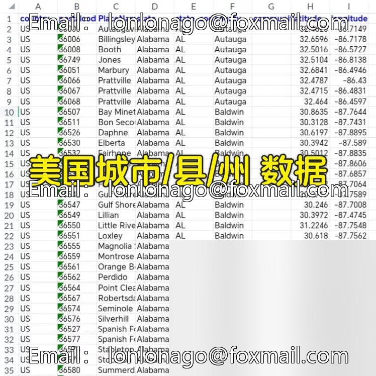

# US cities, counties, states, data (cities-counties-s)

## Body

U.S. Cities-Counties-States Data (cities-counties-states Data), including corresponding counties/states/city codes, postal codes, and area codes, as well as longitude and latitude information;
Data purposes: academic research, data analysis

web-based shipment, can be directly photographed and shipped.

The data covers American cities, counties, states, city codes, postcodes, region codes and lat/long coordinates for academic research and data analysis.

<!-- AI_ENRICHED -->

## Images

## Payment

Here is a pay link on Stripe ( https://buy.stripe.com/3cs8yP7sY87d0vu9AB ). Please contact me lonlonago@foxmail.com after funding $89, and I will send you a complete data files , thank you!

